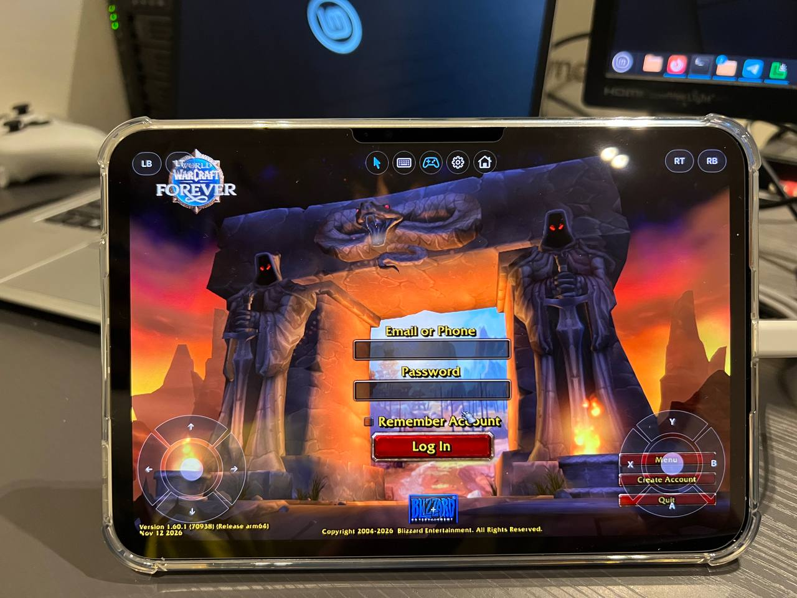
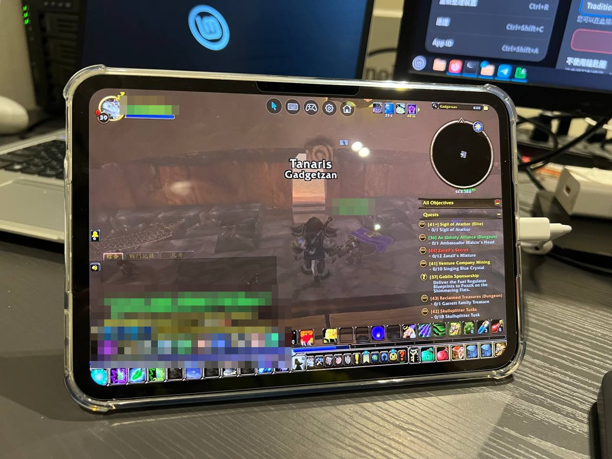

# ipadwow — Running World of Warcraft: Forever natively on iPad

[繁體中文](README.md) | **English**

This repo runs WoW Forever natively on an iPad with the unofficial **WolkaraForever** project, which is built on **Tolkara**.
**You don't need a Mac or a paid Apple Developer account.** A Linux PC, a free Apple ID and a GitHub Actions cloud build are enough.
After the first install, **SideStore** re-signs the apps on the iPad every 7 days, so **you no longer need the computer**.

- Test device: iPad mini 8 (A20 Pro, ~12 GB RAM, 256 GB, iPadOS 27.0)
- Status (2026-11-19): ✅ installed ✅ JIT ✅ game downloaded ✅ Battle.net login, character list reached ✅ Traditional Chinese UI ✅ on-device re-signing (SideStore, 2026-11-19)
- Detailed log and troubleshooting history: [CHANGELOG.md](CHANGELOG.md) (Traditional Chinese)
- `<TEAM_ID>`, `<GITHUB_USER>`, `<IPAD_APPLE_ID>` and similar are placeholders. Replace them with your own values.
- These are personal notes, not official WolkaraForever documentation. This repo does not distribute any IPA.
- Other documents in this repo are in Traditional Chinese.

> ⚠️ Account risk: Tolkara states that "the risk of suspension or ban when using online accounts is real and entirely yours." Blizzard does not support this project. Do not combine it with any add-on automation, bots or cheats.

---

## Screenshots

<p>
  
  
</p>

Left: the login screen. Right: in game at Gadgetzan, Tanaris. The character name and chat are redacted.

---

## How it works

| Component | Role | Source |
|-----------|------|--------|
| **WolkaraForever** (app name: Tolkara) | Loads the unmodified macOS arm64 WoW client on iPad. It downloads, verifies and updates the game from Blizzard's CDN by itself | Your own fork, built into an IPA with GitHub Actions |
| **StikDebug** | Enables JIT (executable memory) for Tolkara. You need it every time you launch the game | Official IPA |
| **LocalDevVPN** | An on-device tunnel that lets StikDebug reach the iPad's own developer service. It does not route normal internet traffic | App Store |
| **SideStore** (nightly) | Re-signs all apps on the iPad with the free Apple ID, **no computer needed**. Can be automated with Shortcuts | Installed with iloader |
| **iloader** (on the Linux PC) | **First install only.** Signs and installs IPAs. **It turns on `increased-memory-limit` on the App ID automatically**, so the app gets enough memory | [nab138/iloader](https://github.com/nab138/iloader) (v2.4.1) |

Free account limits:
- Signatures expire after **7 days**
- At most **3** sideloaded apps and app extensions at once (SideStore, StikDebug and Tolkara use all 3)
- At most 10 new App IDs per 7 days

---

## Requirements

- A Linux PC with `iloader`, `libimobiledevice`, `ifuse` and `gh` (needed only for the first install and for editing config files)
- A USB-C cable
- An Apple-silicon iPad, ideally on iPadOS 27, with **≥ 70 GB free**. The game is ~49 GB, ~51 GB+ with the Chinese language pack, plus space for update staging
- A free Apple ID (a separate one just for sideloading is recommended)
- A GitHub account
- A Battle.net account with access to Forever, plus the Battle.net Authenticator

---

## Installation (from scratch)

### 1. Build the IPA (GitHub Actions, no Mac needed)
1. Fork `jklock/wolkaraforever` and enable Actions on the fork.
2. Upstream `release.yml` has a bug: the IPA is produced in `build/platform/`, but the upload step looks for it in the repo root.
   - Fix it by adding a commit on the version you want to build that makes `wolkaraforever/tools/package_ipa.sh` copy the IPA back to the root, then tag that commit.
   - The workflow file itself is not changed, because editing it needs the `workflow` scope on the gh token.
3. In the same script add `export TOLKARA_SYSTEM_ROOTS=YES` so the IPA bundles root certificates. **Without them, the Forever login is disconnected (BLZ51901016).**
4. Optional, for a Traditional Chinese UI: allow `zhTW` in the language menu and config validation in `WoW/WoWViewController.m` and `Shell/WolkaraForeverConfig.m`.
5. Start the build with `gh workflow run release.yml -f tag=<tag>`.
   - The `macos-26` runner is often not picked up ("job was not acquired… capacity constraints"). Re-run it.
   - Don't switch to macos-15. The build inspects the host's macOS frameworks.
6. Download the IPA from your release into `ipa/`, **then delete the GitHub release**. An IPA that bundles root certificates should not be shared publicly. The tag can stay.

Tags used on the fork:

| Tag | Contents |
|-----|----------|
| `v1.0.17-ipa` | v1.0.17 + IPA upload path fix |
| `v1.0.17-roots` | + bundled root certificates (`TOLKARA_SYSTEM_ROOTS=YES`) |
| `v1.0.17-zhtw` | + zhTW language option ← **currently used** |

### 2. Prepare the iPad
1. Install **LocalDevVPN** from the App Store.
2. Turn on Developer Mode in Settings → Privacy & Security → Developer Mode, then restart.
3. Connect the iPad by USB and tap **Trust**.

### 3. Install with iloader
1. Open iloader, sign in with the iPad's Apple ID, and choose **Jkcoxson** as the Anisette server.
2. Use **Import IPA** to install **StikDebug** (`ipa/StikDebug-3.2.2.ipa`).
3. Use **Import IPA** to install **WolkaraForever** (`ipa/WolkaraForever-v1.0.17-zhtw-unsigned.ipa`).
4. Install **SideStore (nightly)**. The 0.7.0 release could not sign in on this iPad (-45063, HTTP 401).
5. On the iPad, trust your Apple ID in Settings → General → VPN & Device Management.
6. Check the entitlements with `ideviceinstaller -l -o list_user -o xml`. Tolkara must have `com.apple.developer.kernel.increased-memory-limit = true`.

> **Why install Tolkara with iloader first instead of SideStore?** iloader turns on increased-memory-limit on Tolkara's App ID. SideStore doesn't turn it on by itself for a free account (SideStore issue #1616), but it keeps a capability that is already on. So iloader installs first and SideStore takes over afterwards. GetMoreRam is not needed.

### 4. StikDebug pairing file
iloader's "Manage pairing files → Place" did not put the file into StikDebug, so copy it manually:
1. Generate a pairing file with iloader. iOS 26+ needs `PairingFile_RemoteRP.plist`, the one with the RP fields.
2. Mount StikDebug's Documents with `ifuse --documents com.stik.stikdebug.<TEAM_ID> <mountpoint>`.
3. Copy the file in as `pairingFile.plist`, then unmount.
4. Open StikDebug and make sure it shows no error.

### 5. Hand over to SideStore
After this, SideStore does the re-signing. **Don't sign this iPad with iloader again.** A free account can have only one development certificate, so the two tools would revoke each other's.
1. Put the IPAs into SideStore's Documents: `ifuse --documents com.SideStore.SideStore.<TEAM_ID> <mountpoint>`, copy the StikDebug and WolkaraForever IPAs in, then unmount.
2. **Use Remote Pairing.** iloader already put `PairingFile_Lockdown.plist` and `PairingFile_RemoteRP.plist` in SideStore's Documents, but SideStore has no preferred protocol set, so it loads neither at launch.
   - SideStore → Settings → Advanced Settings → **Pairing File Management** → **long-press** the title of the Remote Pairing card → **Set as Preferred**. A plain tap only opens the file view.
   - **Don't use Lockdown.** On iOS 26.4+ it needs an IPSec tunnel, which LocalDevVPN doesn't provide (log: `no ipsec interface`).
   - Relaunch SideStore with LocalDevVPN connected.
3. Sign in with the Apple ID. Settings shows **Action Required** (Active signing certificate pending). Tap it → **Revoke and Resign Now**.
   - This revokes iloader's certificate, so StikDebug and Tolkara stop opening until step 6.
4. For app extensions, choose **Remove App Extensions**. Extensions count toward the 3-app limit. The Refresh All Apps action used by Shortcuts is in the main app, so it isn't affected.
5. SideStore reinstalls itself with the new certificate and closes. Wait for the icon to finish installing, then reopen it.
6. **My Apps** → **＋** (top left) → pick the StikDebug IPA, then **＋** again → pick the WolkaraForever IPA. The bundle IDs don't change, so these install over the existing apps and keep the game files and pairing file.
7. Check Tolkara's increased-memory-limit again.
8. If the `resign/` timer is enabled on the PC, stop it: `systemctl --user disable --now ipad-resign.timer`.

### 6. First launch and game download
1. Connect LocalDevVPN, then in StikDebug:
   1. Tap **Enable JIT**
   2. Long-press Tolkara → **Assign Script** → `universal.js`
   3. Tap Tolkara
2. In Tolkara choose Game Edition **Forever**, Region **Taiwan** and Language **Traditional Chinese** (or English).
3. Tap **Install** and let it download ~49 GB or more. Keep the iPad unlocked with Tolkara in the foreground. When it finishes, the button changes to **Play**.

### 7. Change the login portal (required for Taiwan accounts)
Taiwan accounts log in through the **KR** portal. The app's default `TW` fails with BLZ51901016.
1. **Fully close Tolkara** by swiping it away in the app switcher.
2. Mount it with `ifuse --documents local.tolkara.app.<TEAM_ID> <mountpoint>`.
3. In `World of Warcraft/_forever_/WTF/Config.wtf`, change `SET portal "TW"` to `SET portal "KR"` and leave everything else as it is.
4. Unmount.

### 8. Log in
- Launch Tolkara from StikDebug, tap **Play**, and enter your Battle.net credentials.
- **No approval notification appears on your phone.** Open the Battle.net Authenticator yourself and enter the code it shows (usually 8 digits) before it changes.

---

## Playing

1. Make sure **LocalDevVPN** is connected. You can leave it on, or toggle it in Settings → VPN or in Control Center.
2. Launch Tolkara from StikDebug. **Don't open it from the Home Screen**: it would start without JIT and the game would fail.
3. Tap **Play**.

For one-tap launching, make a Home Screen shortcut with the Shortcuts app. The steps are in [SHORTCUT.md](SHORTCUT.md) (⏳ not yet tested).

To confirm that JIT worked, look for `an arena was reserved at launch` in `wolkaraforever.log`.

---

## Re-signing every 7 days (SideStore, no computer)

- Manually: connect LocalDevVPN → SideStore → **My Apps** → **Refresh All** (top right). Expiry moves to 7 days from now.
- Automatically: Shortcuts → **Automation** → **＋** → **Time of Day** (2–3 times a week, Run Immediately) with these actions (✅ tested 2026-11-19):
  1. **Set VPN** → LocalDevVPN → Connect. If LocalDevVPN isn't listed, use **Open App** → LocalDevVPN instead.
  2. **Wait** 3 seconds.
  3. SideStore's **Refresh All Apps**.
  - Refreshing may need SideStore in the foreground and may not finish while the iPad is locked, so pick a time when you usually use the iPad.
- If the apps have already expired: open LocalDevVPN and SideStore and tap Refresh All.
- Re-signing installs over the existing apps, so game files, the pairing file and `Config.wtf` are kept. **Never delete the app**, or the game data will be lost.
- New IPA version: put it in SideStore's Documents and install it with ＋ in My Apps (same bundle ID).

> Old method: `resign/` drove iloader on the PC to re-sign, which meant connecting the iPad every 7 days. It is disabled now and kept only as a fallback. Re-signing with iloader revokes SideStore's certificate, so you would have to redo "Hand over to SideStore" afterwards.

---

## Problems we hit

| Symptom | Cause | Fix |
|---------|-------|-----|
| Play does nothing or fails, and the log has no `arena was reserved` | Opened from the Home Screen, so there was no JIT | Launch through LocalDevVPN → StikDebug |
| Login **BLZ51901016** (disconnected ~0.6 s after connecting) | ① The IPA has no root certificates ② The portal is set to `TW` | ① Build with `TOLKARA_SYSTEM_ROOTS=YES` ② Set `portal "KR"` in `Config.wtf` |
| `Fatal login error (325)` | Timed out waiting for phone approval, which never arrives | Enter the authenticator code manually |
| Login `(14400)` | Wrong or expired authenticator code | Enter the code before it changes |
| After the first login, the game quits ~5 s after launch | Account sync changed the `Config.wtf` locale to `zhTW`, but the zhTW data wasn't downloaded | Download zhTW in Tolkara, or set `textLocale`/`audioLocale` back to a downloaded locale |
| Download progress freezes with no error | The network stopped responding and the app kept waiting | Fully close Tolkara and relaunch from StikDebug. Downloaded data is kept |
| SideStore sign-in fails (-45063, HTTP 401) | SideStore 0.7.0 issue | Install the **nightly** with iloader |
| SideStore never connects; log shows `pairing file not loaded` | No preferred protocol set | Pairing File Management → long-press Remote Pairing → Set as Preferred |
| SideStore log shows `no ipsec interface (required for lockdown on iOS 26.4+)` | Lockdown is selected | Use Remote Pairing |
| Importing a pairing file fails with `The pairing file format is ambiguous` | The file has both Lockdown and RP fields | Skip the import and set the preferred protocol by long-pressing, or split the file so it has only one kind of field |
| SideStore refresh fails with `Your session has expired (code: 1100)`, and signing in again gives HTTP 503 | Since 2026-11-20 Apple rejects sign-in headers containing `macOS;` ([SideStore#1745](https://github.com/SideStore/SideStore/issues/1745)) | Turn off On-Device Anisette → pick `mac-ani.jkcoxson.com` as the server → in Anisette Client Configuration tap Fetch, then Save as Overrides → set Client Info to `<MacBookPro13,3> <Mac OS X;26.6;25F84> <com.apple.AuthKit/1 (com.apple.akd/1.0)>` → Save Overrides → restart and sign in. **Don't tap Reset to Defaults** (see CHANGELOG 2026-11-22) |
| StikDebug and Tolkara suddenly won't open | Signatures expired, or iloader signed something and revoked SideStore's certificate | Tap Refresh All in SideStore. If the certificate was revoked, redo "Hand over to SideStore" |

---

## Useful commands

```bash
idevice_id -l                                               # is the iPad connected?
ifuse --documents local.tolkara.app.<TEAM_ID> <mountpoint>  # read/write Tolkara's files
fusermount -u <mountpoint>
ideviceinstaller -l -o list_user -o xml                     # apps and entitlements
ideviceinfo -q com.apple.disk_usage                         # free space on the iPad
~/ipadwow/resign/resign.py --status                         # signing expiry (read-only)
```

Useful files in Tolkara's Documents:
- `wolkaraforever.log`: launcher log (JIT, download progress)
- `external-jit-diagnostics.log`: JIT and memory (`memory checkpoint … available=`)
- `wolkaraforever-config.json`: edition, region, language
- `World of Warcraft/_forever_/WTF/Config.wtf`: game settings (`portal`, `textLocale`, `audioLocale`)
- `.tolkara-updates/`: update staging. Files replace the live install only when the update completes, so a failed update doesn't break the existing install.

---

## What a paid account adds (not required)

A paid Apple Developer membership costs US$99/year and gives you:
- Signatures that last one year instead of 7 days. You still need a computer to sign.
- Tolkara's **Developer service** mode, where Tolkara enables JIT by itself. You don't need StikDebug or LocalDevVPN and can just tap the app icon. This mode needs the Network Extension entitlement, which free accounts cannot sign.

Related (Chinese): [APPLE-DEVELOPER-ENROLL.md](APPLE-DEVELOPER-ENROLL.md), [INSTALL-MAC.md](INSTALL-MAC.md) (official Mac route)

---

## Documents

| File | Contents |
|------|----------|
| [CHANGELOG.md](CHANGELOG.md) | Progress, current state, troubleshooting log |
| [SHORTCUT.md](SHORTCUT.md) | One-tap Home Screen shortcut |
| [resign/README.md](resign/README.md) | Old PC-side auto re-sign tool (disabled, fallback) |
| [IPAD-FREE-ROUTE.md](IPAD-FREE-ROUTE.md) | Original plan for the free route (2026-11-17) |
| [RESEARCH.md](RESEARCH.md) | Early research; its "Mac required" conclusion is outdated |
| [INSTALL-MAC.md](INSTALL-MAC.md), [APPLE-DEVELOPER-ENROLL.md](APPLE-DEVELOPER-ENROLL.md) | Paid account and Mac route (backup) |
| `reference/` | Copies of upstream docs (MIT, see `reference/upstream/NOTICE.md`), Blizzard CDN and version data |

## Sources

- WolkaraForever: https://github.com/jklock/wolkaraforever (free Apple ID success report: issue #67)
- Tolkara: https://github.com/tolkara/tolkara
- StikDebug: https://github.com/StikDebug/StikDebug
- iloader: https://github.com/nab138/iloader
- SideStore: https://github.com/SideStore/SideStore
