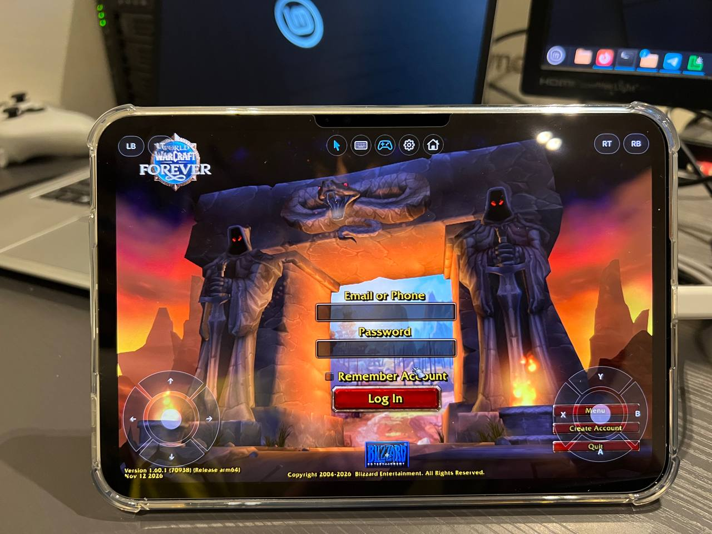
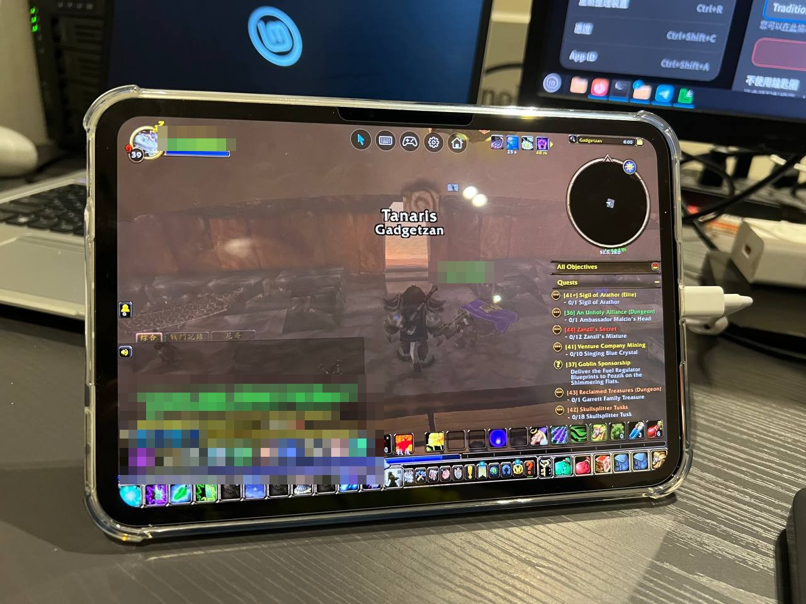

# ipadwow — 在 iPad 上原生執行《魔獸世界：永恆》

**繁體中文** | [English](README.en.md)

用非官方專案 **WolkaraForever**（建立在 **Tolkara** 之上）在 iPad 上原生跑 WoW 永恆。
**不需要 Mac，也不需要付費 Apple Developer 帳號**：用 Linux 電腦、免費 Apple ID，加上 GitHub 雲端編譯就能完成。
裝好之後，每 7 天的重簽由 iPad 上的 **SideStore** 自己完成，**不用再接電腦**。

- 實測機：iPad mini 8（A20 Pro、約 12GB RAM、256GB、iPadOS 27.0）
- 狀態（2026-11-19）：✅ 安裝 ✅ JIT ✅ 遊戲下載 ✅ Battle.net 登入、進到角色列表 ✅ 繁中介面 ✅ iPad 自己重簽（SideStore，2026-11-19）
- 詳細過程和除錯紀錄：[CHANGELOG.md](CHANGELOG.md)
- 文中 `<TEAM_ID>`、`<GITHUB_USER>`、`<IPAD_APPLE_ID>` 等是代號，請換成你自己的值（作者的實際值只存在本機，不在 repo 裡）
- 這是個人實作紀錄，不是 WolkaraForever 官方文件；本 repo 不提供任何 IPA

> ⚠️ 封號風險：Tolkara 官方說「使用線上帳號時，被停權或封號的風險是真實的，而且完全由你承擔」。Blizzard 不支援這個專案。不要搭配任何外掛或自動化工具。

---

## 實機畫面

<p>
  
  
</p>

左：登入畫面。右：遊戲中（塔納利斯．加基森），角色名和聊天框已打碼。

---

## 運作方式

| 元件 | 作用 | 來源 |
|------|------|------|
| **WolkaraForever**（App 名稱 Tolkara） | 在 iPad 上載入未修改的 macOS arm64 版 WoW；自己向 Blizzard CDN 下載、驗證、更新遊戲 | 自己 fork 後用 GitHub Actions 編譯 IPA |
| **StikDebug** | 幫 Tolkara 開 JIT（可執行記憶體），每次開遊戲都要 | 官方 IPA |
| **LocalDevVPN** | iPad 內部的通道，讓 StikDebug 連到 iPad 自己的開發者服務；不轉送一般網路流量 | App Store |
| **SideStore**（每夜建置版） | 在 iPad 上用免費 Apple ID 重簽所有 App，**不用接電腦**；可以用捷徑自動執行 | iloader 安裝 |
| **iloader**（Linux 電腦） | **只在第一次安裝時用**：簽名並安裝 IPA，**會自動在 App ID 上開啟 increased-memory-limit**，App 才拿得到足夠記憶體 | `~/.local/bin/iloader`（v2.4.1） |

免費帳號的限制：簽名 **7 天**到期；同時最多 **3 個**側載 App 加擴充功能（SideStore、StikDebug、Tolkara 剛好 3 個）；每 7 天最多註冊 10 個 App ID。

---

## 需要的東西

- Linux 電腦（只有第一次安裝和改設定檔時需要）：`iloader`、`libimobiledevice`、`ifuse`、`gh`
- USB-C 傳輸線
- Apple 晶片的 iPad，iPadOS 27 為佳，可用空間 **≥ 70GB**（遊戲約 49GB，加中文語言包約 51GB 以上，另有更新暫存）
- 免費 Apple ID（建議另外開一個給 iPad 側載用）
- GitHub 帳號
- 有永恆遊玩資格的 Battle.net 帳號，加上 Battle.net 驗證器

---

## 安裝步驟（從零開始）

### 1. 編譯 IPA（GitHub Actions，不用自己的 Mac）
1. Fork `jklock/wolkaraforever` 到自己的帳號，開啟 Actions
2. 上游的 `release.yml` 有 bug（IPA 產生在 `build/platform/`，上傳步驟卻在根目錄找）。修法是在要編的版本上加一個 commit，讓 `wolkaraforever/tools/package_ipa.sh` 編完後把 IPA 複製回根目錄，再打新標籤。不改 workflow 檔，因為那需要 gh token 的 `workflow` 權限
3. 同一個腳本加上 `export TOLKARA_SYSTEM_ROOTS=YES`，讓 IPA 內含根憑證。**沒有根憑證，Forever 登入會被斷線（BLZ51901016）**
4. 想要繁中介面：改 `WoW/WoWViewController.m`、`Shell/WolkaraForeverConfig.m`，讓語言選單和設定檔允許 `zhTW`
5. 觸發編譯：`gh workflow run release.yml -f tag=<標籤>`
   - `macos-26` runner 常排不到（"job was not acquired… capacity constraints"），重跑就好。不要改用 macos-15，編譯會檢查主機的 macOS 框架
6. 從自己的 Release 下載 IPA 到 `ipa/`，**然後刪掉 GitHub release**：含根憑證的 IPA 不適合公開散布（標籤可以留著）

目前 fork 上的標籤：

| 標籤 | 內容 |
|------|------|
| `v1.0.17-ipa` | v1.0.17 加上 IPA 上傳路徑修正 |
| `v1.0.17-roots` | 再加上根憑證（`TOLKARA_SYSTEM_ROOTS=YES`） |
| `v1.0.17-zhtw` | 再加上 zhTW 語言選項 ← **目前使用** |

### 2. iPad 準備
1. App Store 安裝 **LocalDevVPN**
2. 開啟開發者模式：設定 → 隱私權與安全性 → 開發者模式 → 重開機
3. 用 USB 接電腦並按「信任」

### 3. 用 iloader 安裝
1. 開 iloader，用 iPad 專用的 Apple ID 登入，Anisette 伺服器選 **Jkcoxson**
2. 「匯入 IPA」安裝 **StikDebug**（`ipa/StikDebug-3.2.2.ipa`）
3. 「匯入 IPA」安裝 **WolkaraForever**（`ipa/WolkaraForever-v1.0.17-zhtw-unsigned.ipa`）
4. 安裝 **SideStore（每夜建置版）**。0.7.0 正式版在這台 iPad 上無法登入（-45063、HTTP 401）
5. iPad：設定 → 一般 → VPN 與裝置管理 → 信任自己的 Apple ID
6. 檢查權限：`ideviceinstaller -l -o list_user -o xml`，Tolkara 要有 `com.apple.developer.kernel.increased-memory-limit = true`

> **為什麼先用 iloader 裝 Tolkara，而不是直接用 SideStore 裝？** iloader 會在 Tolkara 的 App ID 上開啟 increased-memory-limit。SideStore 用免費帳號時不會自己開這個功能（SideStore issue #1616），但會沿用 App ID 上已經開好的。所以順序是 iloader 先裝，再交給 SideStore 接手。這樣就不需要 GetMoreRam。

### 4. StikDebug 配對檔
iloader 的「管理配對檔案 → 放入」沒有把檔案放進 StikDebug，所以改成手動：
1. 用 iloader 產生配對檔（iOS 26 以上要用含 RP 欄位的 `PairingFile_RemoteRP.plist`）
2. 掛載 StikDebug 的 Documents：`ifuse --documents com.stik.stikdebug.<TEAM_ID> <掛載點>`
3. 複製成 `pairingFile.plist`，卸載
4. 開 StikDebug，確認沒有錯誤

### 5. 交給 SideStore 接手
完成後由 SideStore 負責重簽。**之後不要再用 iloader 簽這台 iPad**，因為免費帳號只能有一張開發者憑證，兩邊會互相撤銷。
1. 把 IPA 放進 SideStore 的 Documents：`ifuse --documents com.SideStore.SideStore.<TEAM_ID> <掛載點>`，複製 StikDebug 和 WolkaraForever 的 IPA 進去，再卸載
2. **配對檔改用 Remote Pairing**：iloader 已經在 SideStore 的 Documents 放好 `PairingFile_Lockdown.plist` 和 `PairingFile_RemoteRP.plist`，但 SideStore 沒有設定偏好協定，啟動時兩個都不會載入
   - SideStore → Settings → Advanced Settings → **Pairing File Management** → **長按** Remote Pairing 卡片的標題 → **Set as Preferred**（點一下只會進到檔案內容頁）
   - **不要用 Lockdown**：iOS 26.4 以上它需要 IPSec 通道，LocalDevVPN 不提供（log：`no ipsec interface`）
   - 重開 SideStore（LocalDevVPN 要連著）
3. 登入 Apple ID。Settings 裡會出現 **Action Required**（Active signing certificate pending），點下去 → **Revoke and Resign Now**
   - 這一步會撤銷 iloader 的憑證，所以 StikDebug 和 Tolkara 會暫時打不開
4. 擴充功能選 **Remove App Extensions**。免費帳號的 3 個名額也算擴充功能；捷徑用的 Refresh All Apps 在主程式裡，不受影響
5. SideStore 用新憑證重裝自己後會自動關閉，等圖示裝好再重開
6. **My Apps** → 左上角 **＋** → 選 StikDebug 的 IPA；再按 **＋** 選 WolkaraForever 的 IPA。bundle ID 不變，所以是覆蓋安裝，遊戲檔和配對檔都會保留
7. 再檢查一次 Tolkara 的 increased-memory-limit
8. 電腦上如果有開 `resign/` 的 timer，要停掉：`systemctl --user disable --now ipad-resign.timer`

### 6. 第一次啟動與下載遊戲
1. LocalDevVPN 連線 → 開 StikDebug → **Enable JIT** → 長按 Tolkara 選 **Assign Script** → `universal.js` → 點 Tolkara
2. 在 Tolkara 裡選：Game Edition **Forever**、Region **Taiwan**、Language **Traditional Chinese**（或 English）
3. 按 **Install**，讓它下載約 49GB 以上。iPad 不要鎖定，Tolkara 要留在前景。完成後按鈕會變成 **Play**

### 7. 改登入伺服器（台灣帳號必做）
台灣帳號要走 **KR** 的登入伺服器，App 預設的 `TW` 會連不上（BLZ51901016）。
1. **完全關掉 Tolkara**（從多工畫面滑掉）
2. `ifuse --documents local.tolkara.app.<TEAM_ID> <掛載點>`
3. 把 `World of Warcraft/_forever_/WTF/Config.wtf` 裡的 `SET portal "TW"` 改成 `SET portal "KR"`，其他設定不動
4. 卸載

### 8. 登入
- 從 StikDebug 開 Tolkara → **Play** → 輸入 Battle.net 帳密
- **手機不會跳出核准通知**：要自己打開 Battle.net 驗證器，在代碼更新前輸入畫面上的代碼（通常 8 碼）

---

## 每次玩遊戲

1. 確認 **LocalDevVPN** 已連線。可以一直開著，也可以從「設定 → VPN」或控制中心開關
2. 從 StikDebug 點 Tolkara（**不要從主畫面直接開**，那樣沒有 JIT，遊戲會失敗）
3. **Play**

想要一鍵啟動：用捷徑 App 做一個主畫面圖示，步驟見 [SHORTCUT.md](SHORTCUT.md)（⏳ 待實測）。

判斷 JIT 有沒有開成功：`wolkaraforever.log` 裡要有 `an arena was reserved at launch`。

---

## 每 7 天重簽（SideStore，不用電腦）

- 手動：LocalDevVPN 連線 → SideStore → **My Apps** → 右上角 **Refresh All**。到期日會延長成 7 天後
- 自動：捷徑 App → **自動化** → **＋** → **特定時間**（每週 2～3 次、立即執行），動作依序是（✅ 2026-11-19 實測成功）：
  1. **設定 VPN** → LocalDevVPN → 連線（清單裡沒有的話改用「打開 App」→ LocalDevVPN）
  2. **等待** 3 秒
  3. SideStore 的 **Refresh All Apps**
  - Refresh 可能需要 SideStore 在前景，iPad 鎖定時可能跑不完，所以排在常用 iPad 的時段
- 萬一過期打不開：打開 LocalDevVPN 和 SideStore，手動按 Refresh All 就能恢復
- 重簽是覆蓋安裝：遊戲檔、配對檔、`Config.wtf` 都會保留。**不要刪掉 App**，否則遊戲資料會不見
- 換新版 IPA：放進 SideStore 的 Documents，在 My Apps 用 ＋ 安裝（bundle ID 要一樣）

> 舊方法：`resign/` 會在電腦上自動操作 iloader 重簽（需要每 7 天接電腦）。改用 SideStore 後已停用，只留作 SideStore 出問題時的備案。注意：用 iloader 重簽會撤銷 SideStore 的憑證，之後要重新做「交給 SideStore 接手」。

---

## 遇過的問題

| 症狀 | 原因 | 解法 |
|------|------|------|
| 按 Play 沒反應或失敗，log 沒有 `arena was reserved` | 從主畫面直接開，沒有 JIT | 走 LocalDevVPN → StikDebug 流程 |
| 登入 **BLZ51901016**（連上後約 0.6 秒被斷線） | ① IPA 沒有根憑證 ② portal 設成 `TW` | ① 用 `TOLKARA_SYSTEM_ROOTS=YES` 編 ② `Config.wtf` 改 `portal "KR"` |
| 登入 `Fatal login error (325)` | 等手機核准逾時（手機不會跳通知） | 手動輸入驗證器代碼 |
| 登入 `(14400)` | 驗證碼錯誤或過期 | 在代碼更新前輸入 |
| 第一次登入後，再開遊戲約 5 秒就自己關掉 | 帳號同步把 `Config.wtf` 的語言改成 `zhTW`，但 iPad 沒有 zhTW 語言檔 | 在 Tolkara 下載 zhTW 語言檔，或把 `textLocale`/`audioLocale` 改回已下載的語言 |
| 下載進度停住，沒有錯誤 | 網路沒有回應，App 卻一直在等 | 完全關掉 Tolkara，從 StikDebug 重開；已下載的部分會保留 |
| SideStore 登入失敗（-45063、HTTP 401） | SideStore 0.7.0 的問題 | 改用 iloader 安裝**每夜建置版** |
| SideStore 一直沒連上，log 有 `pairing file not loaded` | 沒有設定偏好協定 | Pairing File Management → 長按 Remote Pairing → Set as Preferred |
| SideStore log 有 `no ipsec interface (required for lockdown on iOS 26.4+)` | 用了 Lockdown | 改用 Remote Pairing |
| 匯入配對檔時出現 `The pairing file format is ambiguous` | 檔案同時含 Lockdown 和 RP 欄位 | 不用匯入，直接用長按設定偏好協定；或把檔案拆成只含其中一種欄位 |
| StikDebug、Tolkara 突然全部打不開 | 簽名過期，或有人用 iloader 簽過而撤銷了 SideStore 的憑證 | 在 SideStore 按 Refresh All；憑證被撤銷時重做「交給 SideStore 接手」 |

---

## 常用指令

```bash
idevice_id -l                                             # iPad 有沒有接上
ifuse --documents local.tolkara.app.<TEAM_ID> <掛載點>      # 讀寫 Tolkara 的檔案
fusermount -u <掛載點>
ideviceinstaller -l -o list_user -o xml                   # App 列表和權限
ideviceinfo -q com.apple.disk_usage                       # iPad 剩餘空間
~/ipadwow/resign/resign.py --status                       # 簽名到期日（只讀取，不會重簽）
```

Tolkara 的重要檔案（在它的 Documents 裡）：
- `wolkaraforever.log`：啟動器紀錄（JIT、下載進度）
- `external-jit-diagnostics.log`：JIT 和記憶體（`memory checkpoint … available=`）
- `wolkaraforever-config.json`：版本、地區、語言
- `World of Warcraft/_forever_/WTF/Config.wtf`：遊戲設定（`portal`、`textLocale`、`audioLocale`）
- `.tolkara-updates/`：更新暫存。完成後才會換成正式檔案，所以中途失敗不會弄壞原本的安裝

---

## 付費帳號能多什麼（目前不需要）

付費 Apple Developer（US$99/年）的好處：
- 簽名一年有效，不用每 7 天重簽（簽名時仍需要電腦）
- 可以用 Tolkara 的 **Developer service** 模式：Tolkara 自己開 JIT，不需要 StikDebug 和 LocalDevVPN，直接點圖示就能玩。這個模式需要 Network Extension 權限，免費帳號簽不了

相關文件：[APPLE-DEVELOPER-ENROLL.md](APPLE-DEVELOPER-ENROLL.md)、[INSTALL-MAC.md](INSTALL-MAC.md)（官方 Mac 路線）

---

## 文件索引

| 文件 | 內容 |
|------|------|
| [CHANGELOG.md](CHANGELOG.md) | 實作過程、目前狀態、除錯紀錄（**接續工作先讀這份**） |
| [SHORTCUT.md](SHORTCUT.md) | 主畫面一鍵啟動的捷徑 |
| [resign/README.md](resign/README.md) | 舊的電腦自動重簽工具（已停用，備案） |
| [IPAD-FREE-ROUTE.md](IPAD-FREE-ROUTE.md) | 免費路線的原始規劃（2026-11-17） |
| [RESEARCH.md](RESEARCH.md) | 最初的研究紀錄（「需要 Mac」的結論已過時） |
| [INSTALL-MAC.md](INSTALL-MAC.md)、[APPLE-DEVELOPER-ENROLL.md](APPLE-DEVELOPER-ENROLL.md) | 付費帳號和 Mac 路線（備案） |
| `reference/` | 上游文件備份（MIT，見 `reference/upstream/NOTICE.md`）、Blizzard CDN 和版本資料 |

## 來源

- WolkaraForever：https://github.com/jklock/wolkaraforever （免費 Apple ID 成功案例：issue #67）
- Tolkara：https://github.com/tolkara/tolkara
- StikDebug：https://github.com/StikDebug/StikDebug
- iloader：https://github.com/nab138/iloader
- SideStore：https://github.com/SideStore/SideStore
